# Hyunseo's GitHub 🧑🏻‍💻&nbsp;&nbsp;

 

## 팀 프로젝트

| 프로젝트 | 내 역할 | 소개 |
|---|---|---|
| [레시피 생성 서비스](https://github.com/kgustj/elice-recipe-generator) | 백엔드 리드 | 재료로 KoGPT2가 레시피를 만들어 주는 서비스 |
| [catch-calorie](https://github.com/kgustj/elice-catch-calorie) | 백엔드 | 섭취·소모 칼로리 기록과 히트맵 |
| [레이서 포트폴리오](https://github.com/kgustj/elice-portfolio-share) | 백엔드 | 포트폴리오 작성·공유 서비스 |
| [elice-wiki](https://github.com/kgustj/elice-wiki) | 프론트엔드 | 학습 기록 위키형 커뮤니티 |

## 학습 기록

- [elice-ai-track](https://github.com/kgustj/elice-ai-track): 엘리스 AI 트랙 4기 실습 (JS, Node, React, Python, AI)
- [g-school](https://github.com/kgustj/g-school): G-school 웹 프로젝트 모음
- [clone-coding](https://github.com/kgustj/clone-coding): 클론 코딩 연습 모음
- [hsu](https://github.com/kgustj/hsu): 한성대학교 수업 실습 (C, JavaScript·Node, Python, Java)
- [study-algorithm](https://github.com/kgustj/study-algorithm): 알고리즘 문제 풀이 (백준·프로그래머스)
- [study-node](https://github.com/kgustj/study-node): Node.js 게시판 학습 (Passport·JWT 인증, 메일 발송)

## 개인 프로젝트

- [create-curtaincall-node](https://github.com/kgustj/create-curtaincall-node): 공연 커뮤니티 "커튼콜"을 Node.js로 다시 만든 버전
- [elice-introduce-js](https://github.com/kgustj/elice-introduce-js): 자기소개 웹페이지 (HTML·CSS·JS)
