# Hyunseo's GitHub 🧑🏻‍💻&nbsp;&nbsp;

 

## 팀 프로젝트

| 프로젝트 | 내 역할 | 소개 |
|---|---|---|
| [레시피 생성 서비스](https://github.com/kgustj/elice-recipe-generator) | 백엔드 리드 | 재료로 KoGPT2가 레시피를 만들어 주는 서비스 |
| [catch-calorie](https://github.com/kgustj/elice-catch-calorie) | 백엔드 | 섭취·소모 칼로리 기록과 히트맵 |
| [레이서 포트폴리오](https://github.com/kgustj/elice-portfolio-share) | 백엔드 | 포트폴리오 작성·공유 서비스 |
| [elice-wiki](https://github.com/kgustj/elice-wiki) | 프론트엔드 | 학습 기록 위키형 커뮤니티 |

## 바로 보기

| 페이지 | 내용 |
|---|---|
| [G-school 포트폴리오](https://kgustj.github.io/g-school/portfolio/) | G-school 과정 개인·팀 프로젝트 기록 |
| [커튼콜](https://kgustj.github.io/g-school/curtaincall/Main/) | 연극 정보·커뮤니티 사이트 |
| [깨토리 인포그래픽](https://kgustj.github.io/g-school/infographic-chart/) | Chart.js 인포그래픽 |
| [자기소개](https://kgustj.github.io/elice-introduce-js/public/) | Hyunseo.log 자기소개 페이지 |
| [오목](https://kgustj.github.io/elice-ai-track/01-js/omok/public/) | 15×15 오목 게임 |
| [그림판](https://kgustj.github.io/clone-coding/paintjs-canvas/) | Canvas 그림판 |
| [모멘텀](https://kgustj.github.io/clone-coding/momentom-js/) | 시계·할 일·날씨 시작 화면 |

## 학습 기록

- [elice-ai-track](https://github.com/kgustj/elice-ai-track): 엘리스 AI 트랙 4기 실습 (JS, Node, React, Python, AI)
- [g-school](https://github.com/kgustj/g-school): G-school 웹 프로젝트 모음
- [clone-coding](https://github.com/kgustj/clone-coding): 클론 코딩 연습 모음
